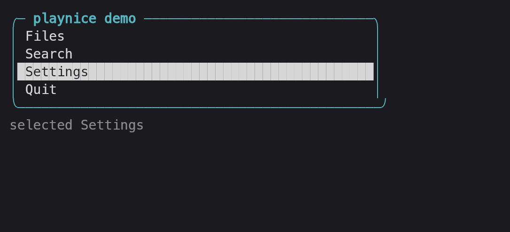

# playnice

Playwright for terminals: run a CLI or TUI in a real pty, read the screen as text, drive it with keys and clicks.

```sh
playnice open -- vim notes.ts   # start (100x30 by default)
playnice key i                  # act
playnice type "hello"           # act
playnice key Escape
playnice snap                   # look — no action
```

Every action returns the **settled screen**, so there is no sleeping and no re-screenshotting to find out what happened.

**0.1.1** · Node 20+ · macOS + Linux · MIT



## Install

```sh
npm i -g playnice
```

Or from source:

```sh
git clone https://github.com/paradise-runner/playnice && cd playnice
npm install && npm run build && npm link
```

If spawning fails with `posix_spawnp failed`, npm blocked `node-pty`'s install script:

```sh
chmod +x node_modules/node-pty/prebuilds/*/spawn-helper
```

## What a screenshot looks like

```
# 62x10 alt cursor=44,0 settled=77ms
export const greet = (name) => `hi ${name}`;
~
~
-- INSERT --
# attrs
1-8:0-61 fg=12
9:0-11 bold
```

- `alt` = full-screen TUI; `main` = scrolling output.
- `cursor=44,0` = 0-based cell, same coordinates `click` takes.
- `settled=false` = still drawing (the frame may be mid-update).
- `# attrs` = the highlights and colours characters cannot show. **This is how you see selection and focus.**

Spec: [docs/snapshot-format.md](docs/snapshot-format.md)

## Commands

| Command | Does |
| --- | --- |
| `open [--cols 100 --rows 30] -- <cmd>` | start a session; prints the first screen |
| `send "…"` / `type "…"` | text + Enter / text only |
| `key Down Enter C-c Escape` | named keys and chords |
| `click 12 4` · `drag 1 2 20 2` · `scroll 10 5 --down 3` | mouse |
| `snap [--ansi --json] [--scrollback n]` | screenshot |
| `shot -o app.png` | real PNG |
| `wait --text "Done" --timeout 120000` | block until text / regex / idle / exit |
| `resize 80 24` · `close` · `ls` | lifecycle |
| `run -- npm test` | run to exit, pass the code through |

Sessions persist in a daemon, shared by the CLI and MCP. Coordinates are 0-based cells.

## MCP

```json
{ "mcpServers": { "playnice": { "command": "playnice", "args": ["mcp"] } } }
```

15 `terminal_*` tools. Setup and the loop that works: [docs/using-mcp.md](docs/using-mcp.md).

## Limits

- **Linux:** a large burst that exits instantly can lose its tail (node-pty read race — [#1](https://github.com/paradise-runner/playnice/issues/1)). macOS unaffected.
- **Not a test framework:** no assertion DSL, no runner integration.
- **Emulation:** no inline images (sixel/kitty), no clipboard reads, SGR-1006 mouse only.
- **Settling is a heuristic:** spinners never settle — the header says `settled=false`; use `wait`.
- **Local only:** Unix socket, no auth, one user. No network, no telemetry.
- **Not Windows:** paths exist, untested.

All of it: [docs/limits.md](docs/limits.md).

## Docs

[Snapshot format](docs/snapshot-format.md) · [How it works](docs/how-it-works.md) · [MCP](docs/using-mcp.md) · [Limits](docs/limits.md) · [ADRs](docs/adr) · [Contributing](CONTRIBUTING.md) · [For agents](AGENTS.md)

## License

MIT
