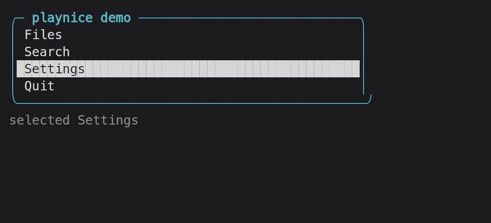

# playnice

A Playwright-style driver for terminals: it runs a CLI or TUI in a real pseudo-terminal, emulates the screen, and hands back a screenshot an agent can read.

**Status:** 0.1.0, working prototype. A Node CLI, an MCP server on stdio, and a TypeScript library over one core. Sessions live in a background daemon, so an agent can drive one terminal across many tool calls without a restart.



## What playnice does

- Starts any program in a pseudo-terminal sized by you (default 100x30) and keeps it alive between calls.
- Returns a **text screenshot** after every action: a one-line header with geometry, cursor, screen type and whether the app finished drawing, then the screen, then an `# attrs` block naming the highlighted spans that characters alone cannot show.
- Waits for the screen to *settle* after each action instead of making the caller sleep and re-screenshot.
- Sends named keys (`C-c`, `Down`, `Shift+Tab`, `F5`), bracketed paste, SGR mouse clicks, drags and wheel events.
- Resizes the pty so TUIs reflow, and reports the new geometry in the next screenshot.
- Renders a real **PNG** when colour, alignment or unicode width are the point.
- Exposes the same primitives three ways: `playnice` on the command line, `terminal_*` MCP tools, and `new Session()` in TypeScript.

## Install

### Requirements

- Node 20 or newer (developed on Node 26).
- macOS (tested) or Linux (same code paths, untested here). Windows is untested; see [Limits](#limits-v01).
- A monospace font on the system, for PNG screenshots only.

```sh
git clone <this repo> playnice
cd playnice
npm install
npm run build
npm link          # optional: puts `playnice` on your PATH
```

`npm install` must be allowed to run `node-pty`'s install script, which marks its bundled `spawn-helper` executable. If npm blocks install scripts (npm 11 does by default) and spawning fails with `posix_spawnp failed`, run:

```sh
chmod +x node_modules/node-pty/prebuilds/*/spawn-helper
```

## First run

```sh
$ playnice open --id demo --cols 62 --rows 10 -- vim -u NONE -N -n notes.ts
# 62x10 alt cursor=0,0 settled=127ms

~
~
~
~
~
~
~
~
"/tmp/notes.ts" [New]
# attrs
1-8:0-61 fg=12

$ playnice key demo i
$ playnice type demo 'export const greet = (name) => `hi ${name}`;'
# demo · changed · settled 77ms · rev 2
# 62x10 alt cursor=44,0 settled=77ms
export const greet = (name) => `hi ${name}`;
~
~
~
~
~
~
~
~
-- INSERT --
# attrs
1-8:0-61 fg=12
9:0-11 bold
```

The first line is the part that makes a screenshot usable:

```
# 62x10 alt cursor=44,0 settled=77ms
```

`62x10` is columns x rows, `alt` means the app took the alternate screen (a full-screen TUI), `cursor=44,0` is the cursor cell (0-based, the same coordinates `playnice click` takes), and `settled=77ms` means the app had been quiet for 77ms when the screenshot was taken. If an app is still drawing the header says `settled=false quiet=12ms` and you know the frame may be mid-update.

`# attrs` lists the style spans that characters alone cannot express — here the eight tilde rows share one style so they collapse into `1-8:0-61 fg=12`, and `-- INSERT --` on row 9 is bold. That is also how you see which row is selected: a TUI draws selection as reverse video over unchanged text.

The `# demo · changed · settled 77ms · rev 2` line goes to stderr, so `playnice snap > screen.txt` is clean screen text. `changed` answers "did my keystroke do anything"; `rev` is the screen revision, which only advances when visible content changes.

## Use

| I want to… | Command |
| --- | --- |
| Open a TUI or shell | `playnice open -- vim`, `playnice open` (your `$SHELL`) |
| See the current screen | `playnice snap`, `playnice snap --ansi` (colours), `--json` (data) |
| Run a command in the session | `playnice send "ls -la"` |
| Type without submitting | `playnice type "Ada"` |
| Press keys | `playnice key Down Enter`, `playnice key C-c` |
| Click / drag / scroll | `playnice click 12 4`, `playnice drag 1 2 20 2`, `playnice scroll 10 5 --down 3` |
| Wait for slow output | `playnice wait --text "Done"`, `--regex 'ready|listening'`, `--idle 500` |
| Change the layout | `playnice resize 80 24` |
| Save a PNG | `playnice shot -o shot.png` (prints the path) |
| Run something to completion | `playnice run -- npm test` (exit code passes through) |
| List / kill sessions | `playnice ls`, `playnice close` |
| Drive it from an agent | `playnice mcp` — see [docs/using-mcp.md](docs/using-mcp.md) |
| Script it in TypeScript | `import { Session } from "playnice"` — see [docs/how-it-works.md](docs/how-it-works.md) |
| Understand a screenshot | [docs/snapshot-format.md](docs/snapshot-format.md) |

Coordinates are 0-based cells from the top-left of the screen. `playnice help <command>` prints the flags for one command.

Newlines, tabs and escape characters in `send`/`type` are delivered as one bracketed paste when the app enabled mode 2004, so multi-line text does not turn into a burst of Enter presses.

## Limits (v0.1)

**Scope.** playnice drives terminals; it is not a test framework. There is no assertion DSL, no test runner integration, no trace viewer and no video recording. The library exports everything a runner would need, but you write the assertions.

**Terminal emulation.** The screen comes from `@xterm/headless`, so playnice sees what xterm.js sees. Inline images (sixel, kitty, iTerm2) are not captured — text screenshots show nothing where an app paints one, and PNG screenshots leave that area blank. OSC 52 clipboard writes are not readable, OSC 8 hyperlinks are not exposed, and blink is reported as an attribute rather than as timing.

**Screenshots are lossy on purpose.** Trailing blank rows are trimmed (`--full` keeps them) and trailing spaces are trimmed unless they are styled, so a right-aligned value at the end of a line loses its padding. The `# attrs` block names style spans, not individual cells; with more than 60 spans it truncates with a `# ... N more` line. Concealed text is still present in the text, flagged `conceal`.

**Settling is a heuristic.** "Settled" means no output *and* no input for 75ms (200ms on `open`; up to 350ms after a bare `Escape`, because apps wait out the ambiguity before redrawing). An app that animates forever — a clock, a spinner, a log tail — never settles: the action returns after `--timeout` (1500ms by default) with `settled=false` and whatever frame is current. A program that is silent before it paints is only handled at `open`, which waits up to 2.5s for the first byte; after that, use `wait --text`, `--regex` or `--idle`. An app slower than ~75ms per repaint can still be screenshotted mid-thought: the header says `settled=false` when playnice knows, and `wait` is the reliable answer when it does not.

**Input.** Mouse is SGR 1006 only; an app that negotiates only X10 or urxvt encodings will ignore clicks. Key names cover letters, digits, arrows, Home/End/PageUp/PageDown, Delete/Insert, F1–F12 and Shift/Alt/Ctrl combinations; media keys and the kitty keyboard protocol are not supported. Text is written in one chunk with no input-side flow control, and there is no IME support.

**Daemon and storage.** Sessions are owned by a background daemon reachable through `~/.playnice/daemon.sock` (mode 0600, no authentication — any process running as your user can drive your terminals). `daemon.json`, `daemon.pid` and `daemon.log` live beside it. Sessions die with the daemon: `playnice daemon stop`, or 12 hours after the last session and client disappear. A CLI and daemon from different builds cannot talk; the mismatch closes all sessions and starts a fresh daemon. Nothing survives a reboot and there is no session history to replay. Scrollback is 2000 lines per session. PNGs written by `shot` default to `~/.playnice/screenshots/` and are never deleted by playnice.

**Linux output tail (v0.1.0).** When a child writes a large burst of output and exits immediately, `node-pty`'s read stream on Linux can report end-of-file before every byte has been read, so the last lines of that burst can be missing. It is a race in the pty read path, not in the emulator: the same burst lost its tail in 3-4 of 6 runs in a container, and macOS is unaffected. Long-running and streaming commands do not trigger it, because the child stays alive while its output is read; `vim`, pagers and shells are unaffected in practice. The fix is to replace the read path, which is a 0.2.0 change — the burst test is skipped on Linux and the investigation is written up in [#4](https://github.com/paradise-runner/playnice/issues/4). Verify with `wait --text <marker>` on text printed before the burst.

**Platform.** macOS is what this checkout is developed and tested on. Linux is exercised by the test workflow on Ubuntu for Node 20, 22 and 24, with the exception noted above. Windows paths exist (named pipe instead of a socket, `node-pty` prebuilds) and are untested; there is no CI in this repository. PNG text uses the first available monospace font with CJK/emoji fallbacks; ligatures and colour emoji depend on what the system provides. Box-drawing and block characters are drawn geometrically, not taken from the font.

**Network.** playnice makes no network requests and has no telemetry. Its only socket is the local Unix socket above. Verify with `rg -n "fetch|https?://" src`.

## How it runs

`playnice` (CLI) and `playnice mcp` are thin clients. They talk newline-delimited JSON over a Unix socket to a daemon that owns the ptys and the emulated screens. A session is a `node-pty` process plus an `@xterm/headless` terminal; a screenshot is read straight from that terminal's buffer, and an action returns once output has been quiet for a moment.

| Change | What it takes |
| --- | --- |
| `src/core/*`, `src/cli/*`, `src/mcp/*` | `npm run build`; the next command notices the build stamp and replaces the daemon (closing live sessions) |
| Session state after an upgrade | it is lost by design — restart the TUI |
| Tests | `npm test` (builds first, then runs `node --test`) |

Details: [docs/how-it-works.md](docs/how-it-works.md).

## Development

```sh
npm run build      # tsc + build stamp
npm test           # build, then node --test over dist/test
npm run typecheck  # tsc --noEmit
```

Tests drive a real TUI fixture ([src/test/fixtures/menu.ts](src/test/fixtures/menu.ts)), the CLI and daemon end to end, the MCP server over stdio, and — when installed — real `vim` and `less`.

## Contributing

See [CONTRIBUTING.md](CONTRIBUTING.md). Behaviour changes update the matching doc; the Limits section is re-read whenever a command, surface or supported platform changes.

## Decisions

- [ADR 0001](docs/adr/0001-daemon-owns-the-ptys.md) — a daemon owns the ptys.
- [ADR 0002](docs/adr/0002-text-first-screenshots.md) — screenshots are text first, PNG second.
- [ADR 0003](docs/adr/0003-settle-on-quiet.md) — actions return when output goes quiet.
- [Screenshot format](docs/snapshot-format.md) · [How it works](docs/how-it-works.md) · [MCP setup](docs/using-mcp.md) · [Agent notes](AGENTS.md)

## License

MIT
